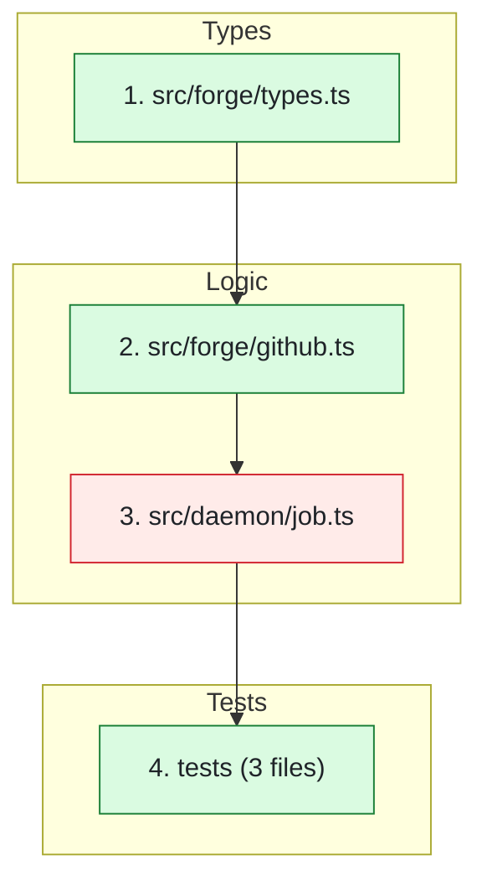

<!--
Design spec for two additions to the review comment prwatch posts on PRs: a
Mermaid "suggested review order" diagram and an overall merge-confidence rating.
Read this before changing DEFAULT_RUBRIC in src/rubric.ts. The rubric is the only
place the review format is defined, and every review the daemon posts uses it.
-->

# Review Order Diagram + Merge Confidence

**Date:** 2026-10-11
**Status:** Implemented

## Problem

The review comment lists issues, but it doesn't answer the two things a human
reviewer asks first:

1. **"Where do I start reading?"** On a 15-file PR, reading in alphabetical order
   (GitHub's default) means seeing callers before the code they call.
2. **"How worried should I be?"** Today the only "confidence" is per fix
   (Safe ✓ / Verify ⚡ / Careful ⚠️, meaning how risky the *suggested fix* is).
   Nothing rates the PR as a whole.

## What we're adding

Two new sections in the review comment, right after **Summary**:

````markdown
**🎯 Merge Confidence:** Medium 🟡 — the retry logic has no timeout test.

**🧭 Review Order**

1. types.ts — the new `headSha` field everything else depends on
2. github.ts — fills that field from the API
3. job.ts — ⚠️ retry loop has no timeout (see Major Concerns)
...
````

GitHub draws ` ```mermaid ` blocks as diagrams in comments, so this needs no
extra tooling.

## Design

### Where the change lives

**Rubric only** (`DEFAULT_RUBRIC` in `src/rubric.ts`). No changes to `prompt.ts`,
the daemon, or the GitHub adapter. The agent already reads the diff, so it can
work out the order and the rating.

### Merge confidence: the rules

Three levels, set **mechanically from the findings** so the rating can't
disagree with the issues listed below it:

| Level | Rule |
|---|---|
| **Low 🔴** | Any 🔥 Critical issue, **or** source code behavior changed with no tests (docs/config-only PRs are exempt) |
| **Medium 🟡** | Any ⚠️ Major issue (and Low doesn't apply) |
| **High 🟢** | Neither of the above |

Always followed by a one-line reason.

Its name is **Merge Confidence**, never just "Confidence", to keep it separate
from the existing per-fix `**Confidence:**` field.

### Review order: the rules

- Order: where the change starts (types/schema → core logic) → its callers →
  tests → docs/config.
- One node per file. **Lockfiles, generated files, snapshots:** one grouped node,
  or left out.
- **At most 12 nodes.** Past that, group by folder (`"5. src/tui/ (4 files)"`).
- **1–2 files changed:** skip the diagram and write one line ("Read X, then Y").
- Every label goes in double quotes, so `/`, `.` and `[]` in paths don't break
  Mermaid.
- Under the diagram, one numbered line per node saying why to read it there.

### Review order: styling

Plain Mermaid only. GitHub supports both features below in comments.

- **Color by risk:** nodes with a 🔥 Critical or ⚠️ Major issue get class `risk`
  (red). Everything else gets `clean` (green). The rubric pins the two
  `classDef` lines exactly as in the example, so colors are the same on every PR.
- **Why fixed colors:** light fills with dark text (`color:#1f2328`) stay
  readable in both GitHub's light and dark themes. Mermaid's default colors
  don't change with the theme, so we set them.
- **Group by layer:** wrap nodes in a `subgraph` per layer (Types, Logic, UI,
  Tests, Docs/Config). Leave out empty layers. Arrows run between groups in
  reading order.
- **Subgraph ids** (`types`, `logic`...) must differ from node ids (`A`, `B`...).
  Mermaid errors when they collide.
- **1–2 file PRs:** still no diagram (see above), so no styling either.

### Upgrading existing installs

`ensureHomeRubric` only replaces `~/.prwatch/rubric.md` if it exactly matches a
shipped default. It already does this for `LEGACY_DEFAULT_RUBRIC`. This change
keeps the current default as `CANDID_V1_RUBRIC` and migrates it the same way.

- Un-edited rubric → gets the new sections automatically.
- Edited rubric, or a repo override at `.prwatch/rubric.md` → **does not** get
  them. Add a README line saying how to copy them in.

## Edge cases

| Case | Behavior |
|---|---|
| Agent writes Mermaid that doesn't parse | GitHub shows an error box where the diagram should be. The rest of the comment still renders. We accept this; no validation step (see decision 2). |
| Agent leaves out the sections | The comment posts without them. Same as any rubric section today: nothing enforces the format. |
| Huge PR (100+ files) | Folder grouping keeps it ≤12 nodes. |
| PR has no issues | Summary says so; Merge Confidence (set by the usual rules), Review Order and What's Good still appear. Only the empty issue categories are left out. |
| Only docs/config changed | The diagram still applies. Rating is High unless the agent flags issues. |
| Malicious file name in the PR | Labels are quoted, and GitHub renders Mermaid in a sandbox (an isolated frame that can't touch the page), so the worst case is a broken diagram. |

## Alternatives considered

**Image diagrams (e.g. `/archify` → PNG posted in the comment).** Rejected:

- GitHub has no public API for uploading images to a comment, so images must be
  hosted elsewhere.
- Hosting elsewhere leaks private repos' file structure to a public URL.
  Committing images to the repo means pushing to the author's branch.
- `/archify` is a Claude Code skill, so Codex and OpenCode users would get no
  diagram. That breaks the "use any agent" promise.
- Turning HTML/SVG into a PNG needs a headless browser in the daemon.

Mermaid renders inside the comment, works on private repos, and every agent
can write it.

## Out of scope

- Checking the Mermaid in code before posting
- Using the rating as a GitHub status check (pass/fail on the PR)
- Inline (line-by-line) comments

## Done when

1. `rubric.test.ts` asserts the new sections are in `DEFAULT_RUBRIC`
   (`**🎯 Merge Confidence:**`, `**🧭 Review Order**`, ` ```mermaid `, both
   `classDef` lines, `subgraph`).
2. A test proves an un-edited `CANDID_V1_RUBRIC` gets migrated.
3. `npm run typecheck` and `npm test` pass.
4. **Manual:** run the daemon against a real 5+ file PR. The diagram renders on
   GitHub, its order makes sense, and the rating matches the issues listed.
5. README mentions both sections and how to add them to a custom rubric.

## Decisions (were open questions)

1. **"No tests" → Low** applies only when source code behavior changed.
   Docs/config-only PRs are exempt.
2. **Broken Mermaid is accepted.** No validation step; GitHub shows an error box
   and the rest of the comment still renders. Revisit if it happens often.
3. **Rating stays after Summary**, not on the first line. Revisit if email
   previews turn out to matter.
